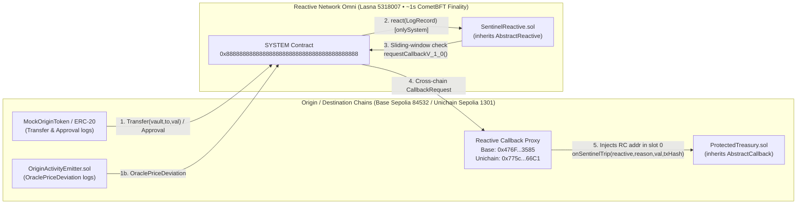

# Reactive Sentinel Omni

> **Autonomous Cross-Chain Wallet & Vault Self-Defense Circuit Breaker** built for the **Reactive Omni Buildathon** (Target Track: **Set It and Forget It** / **Every Second Counts**).

Reactive Sentinel Omni monitors ERC-20 `Transfer` outflows, suspicious `Approval` allowances, and `OraclePriceDeviation` events across **Base Sepolia** and **Unichain Sepolia**, tracks sliding-window outflow velocity in ~1-second CometBFT finality on **Reactive Network Omni (`Lasna Testnet`)**, and automatically dispatches authenticated cross-chain callbacks (`requestCallbackV_1_0`) back to `ProtectedTreasury` to freeze compromised hot keys before funds can be drained — **with zero off-chain servers, cron jobs, or keeper bots**.

---

## Architecture: Origin → `react()` → Callback



### Why Reactive Omni?
1. **Zero Off-Chain Infrastructure ("Set It and Forget It")**: No Gelato/Chainlink keepers, no AWS cron listeners. Event subscriptions (`SYSTEM.subscribe`) live directly in Reactive Network nodes.
2. **Sub-Second Defense ("Every Second Counts")**: Reactive Omni runs on CometBFT (~1s block time, instant finality, zero reorgs). If a hot `guardianOperator` key is compromised, the very first anomalous outflow or unlimited approval trips the circuit breaker before subsequent drain transactions succeed.
3. **Filtered Low-Gas Subscriptions**: `SentinelReactive` subscribes with `topic1 = uint256(uint160(vault))`, so Reactive nodes deliver **only** `Transfer` and `Approval` events originating from the protected vault.
4. **Dual-Layer Callback Authentication**: `ProtectedTreasury` inherits Reactive Omni's `AbstractCallback`, enforcing both `onlyServiceProvider` (originating from the official chain Callback Proxy) and `onlyCallbackSender` (slot 0 injected by Reactive Network matches the authorized `SentinelReactive` contract).

---

## Verified Reactive Omni Network Parameters

| Network | Role | Chain ID | RPC URL | System / Callback Proxy Address | Explorer |
| :--- | :--- | :---: | :--- | :--- | :--- |
| **Reactive Lasna** | Reactive Hub | `5318007` | `https://lasna-rpc.rnk.dev/` | `0x8888888888888888888888888888888888888888` (`SYSTEM`) | [lasna.reactscan.net](https://lasna.reactscan.net/) |
| **Reactive Mainnet** | Reactive Hub | `1597` | `https://mainnet-rpc.rnk.dev/` | `0x8888888888888888888888888888888888888888` (`SYSTEM`) | [reactscan.net](https://reactscan.net/) |
| **Base Sepolia** | Origin / Dest | `84532` | `https://sepolia.base.org` | `0x476F44b11F5C942c58f4c8E3d0300E5710743585` | [sepolia.basescan.org](https://sepolia.basescan.org/) |
| **Unichain Sepolia** | Origin / Dest | `1301` | `https://sepolia.unichain.org` | `0x775c9B990ADe401060B78D0e98684eEf8d2466C1` | [sepolia.uniscan.xyz](https://sepolia.uniscan.xyz/) |
| **Ethereum Sepolia** | Origin / Dest | `11155111` | `https://ethereum-sepolia-rpc.publicnode.com` | `0xAa14d9Cd0f788Ca23d11805986C1d8bd035D23b4` | [sepolia.etherscan.io](https://sepolia.etherscan.io/) |

> **Vendored Official Interfaces**: [`contracts/reactive/`](contracts/reactive/) contains exact copies of `@reactive/src/` from `Reactive-Network/reactive-lib-omni` (`ISystemContract.sol`, `IReactive.sol`, `ISubscriptionService.sol`, `IPayer.sol`, `IPayable.sol`, `AbstractReactive.sol`, `AbstractCallback.sol`, `AbstractPayer.sol`).

---

## Smart Contracts

- [`contracts/SentinelReactive.sol`](contracts/SentinelReactive.sol) — Deployed on Reactive Lasna (`5318007`). Monitors `Transfer`, `Approval`, and `OraclePriceDeviation` across origin chains, tracks per-vault sliding-window velocity (`windowStart`, `windowOutflow`), enforces spender whitelists and cooldowns, and calls `SYSTEM.requestCallbackV_1_0(...)`.
- [`contracts/ProtectedTreasury.sol`](contracts/ProtectedTreasury.sol) — Deployed on Base Sepolia / Unichain Sepolia. Holds ERC-20 treasury funds, isolates day-to-day `guardianOperator` permissions from cold `owner()`, locks withdrawals & approvals upon authenticated `onSentinelTrip(reactive_, reasonCode_, observedValue_, originTxHash_)`, and lets only the cold `owner()` run `unfreezeAndRecover(...)`.
- [`contracts/OriginActivityEmitter.sol`](contracts/OriginActivityEmitter.sol) — Emits `OraclePriceDeviation(asset, deviationBps, currentPrice, baselinePrice, timestamp)` telemetry on origin chains.
- [`contracts/MockOriginToken.sol`](contracts/MockOriginToken.sol) — Testnet ERC-20 (`mUSDC`) with capped public `faucetMint`.

---

## Quick Start (Local Build, Tests & Dashboard)

### 1. Install & Run Smart Contract Tests
```bash
npm install
npx hardhat compile
npx hardhat test
npx hardhat run scripts/simulate-breach.js
```

### 2. Run the Interactive Frontend Dashboard
```bash
cd frontend
npm install
npm run dev
# Or production build:
npm run build
```

---

## Live Testnet Deployment & Verification

### Step 1 — Get Testnet Funds (Faucets)
1. **Base Sepolia ETH**: Claim from Coinbase / Alchemy / Superchain Base Sepolia faucet.
2. **Unichain Sepolia ETH**: Claim from Unichain Sepolia faucet or Superchain faucet.
3. **Reactive Lasna `lREACT`** (Official Faucet Contract — `1 ETH → 100 lREACT`, max `5 ETH` per tx):
   - **On Base Sepolia**: Send `0.1 ETH` to `0x2afaFD298b23b62760711756088F75B7409f5967`
   - **On Ethereum Sepolia**: Send `0.1 ETH` to `0x9b9BB25f1A81078C544C829c5EB7822d747Cf434`

> **MetaMask Note**: When sending transactions on Reactive Lasna, disable **MetaMask → Settings → Advanced → Smart Transactions** (Reactive Network is not supported by MetaMask's Smart Transactions relay).

### Step 2 — Configure `.env`
```bash
cp .env.example .env
# Add PRIVATE_KEY (never commit .env!)
```

### Step 3 — Deploy in Exact Reactive Omni Order
Reactive Network requires breaking the circular address dependency by deploying the reactive contract first:

```bash
# 1. Deploy SentinelReactive on Reactive Lasna (5318007) — funded with 0.2 lREACT
npm run deploy:lasna
# Copy printed SENTINEL_REACTIVE_ADDRESS into .env

# 2. Deploy ProtectedTreasury + MockOriginToken + OriginActivityEmitter on Base Sepolia (84532)
npm run deploy:base
# (Optional) Also deploy on Unichain Sepolia (1301):
npm run deploy:unichain
# Copy printed ORIGIN_VAULT_ADDRESS, ORIGIN_TOKEN_ADDRESS, ORIGIN_EMITTER_ADDRESS into .env

# 3. Register VaultPolicy & activate SYSTEM.subscribe() on Reactive Lasna
npm run wire:lasna
```

### Step 4 — Verify Funding, Debt & Callbacks (`cast`)
```bash
# Check Reactive contract debt & reserves on Lasna
cast call 0x8888888888888888888888888888888888888888 "debt(address)" $SENTINEL_REACTIVE_ADDRESS --rpc-url https://lasna-rpc.rnk.dev/ | cast to-dec
cast call 0x8888888888888888888888888888888888888888 "reserves(address)" $SENTINEL_REACTIVE_ADDRESS --rpc-url https://lasna-rpc.rnk.dev/ | cast to-dec

# Top up callback reserves on Base Sepolia Proxy (0x476F...)
cast send --rpc-url https://sepolia.base.org --private-key $PRIVATE_KEY 0x476F44b11F5C942c58f4c8E3d0300E5710743585 "depositTo(address)" $BASE_VAULT_ADDRESS --value 0.05ether

# Inspect delivered cross-chain callbacks for a Reactive tx hash
cast call 0x8888888888888888888888888888888888888888 "getCallbacks(uint256)((uint256,address,uint256,uint256,uint256,bytes)[])" $REACTIVE_TX_HASH --rpc-url https://lasna-rpc.rnk.dev/
```

---

## Verified Live Testnet Deployment (Lasna + Ethereum Sepolia)

### Deployed Contract Addresses
- **Reactive Lasna (`5318007`):**
  - `SentinelReactive`: `0x7d0Ea4C30A35f9e0bF3A6aCC3970620d7Deb687c`
- **Ethereum Sepolia (`11155111`):**
  - `ProtectedTreasury` (Vault): `0xca68eD28f1E75B8E8dB7b483a1F6A9E822007689`
  - `MockOriginToken` (`mUSDC`): `0xb21281AB80f826DbaA629B3e63E8Dce1319cF49b`
  - `OriginActivityEmitter`: `0x8363cF50a9C0A02Fd846C1dE03efC27d6F685b9B`

### Full-Loop Verification (Origin Event -> `react()` -> Callback Freeze)
1. **Subscription & Wiring (Lasna):** [`0x68ca538879c7cc2c8cc6b4fafd0ba7de6a01016cec6af5e1774d003fcc101854`](https://lasna.reactscan.net/tx/0x68ca538879c7cc2c8cc6b4fafd0ba7de6a01016cec6af5e1774d003fcc101854)
2. **Origin Breach Event (Sepolia Block `12165588`, ts `1795055844`):** [`0x7898596c2d3ce4331549b133c0acfa1b5cbff35f788effb1f050c98483fcd8f8`](https://sepolia.etherscan.io/tx/0x7898596c2d3ce4331549b133c0acfa1b5cbff35f788effb1f050c98483fcd8f8) — `withdrawToken` of `1,200 mUSDC` exceeding `1,000 mUSDC` single-tx threshold.
3. **Reactive `react()` & Callback Request (Lasna Block `8699951`, ts `1795055844`):** [`0x99de5abf68ce41c688f18a141497acd4b925ec7faeb46c72c04f533299465322`](https://lasna.reactscan.net/tx/0x99de5abf68ce41c688f18a141497acd4b925ec7faeb46c72c04f533299465322) — emitted `CircuitBreakerTriggered` and dispatched `requestCallbackV_1_0()`.
4. **Destination Callback `onSentinelTrip()` Freeze (Sepolia Block `12165589`, ts `1795055856`):** [`0x43e9f10a89cd3a19df442655966e1e9e26b980ecf8ae5f17633232a3da475038`](https://sepolia.etherscan.io/tx/0x43e9f10a89cd3a19df442655966e1e9e26b980ecf8ae5f17633232a3da475038) — executed in **1 Sepolia block (+12s full-loop latency)**, flipping `ProtectedTreasury.frozen()` to `true`.

---

## License

MIT — see [LICENSE](LICENSE).
